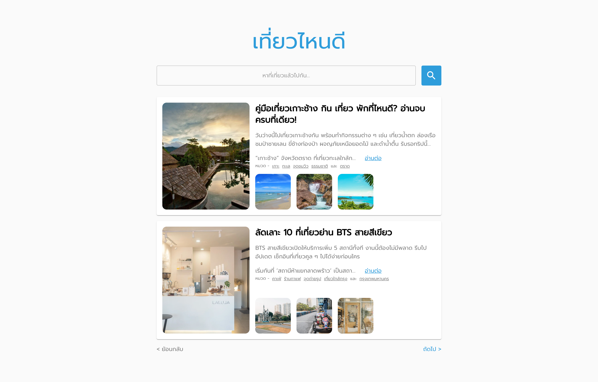
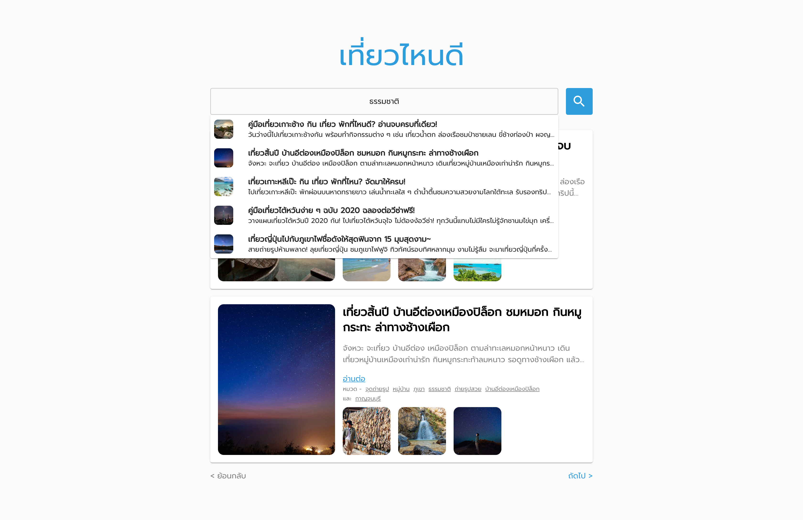
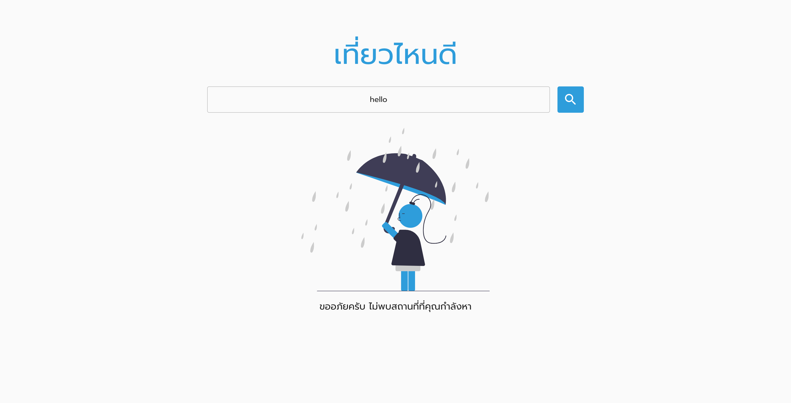
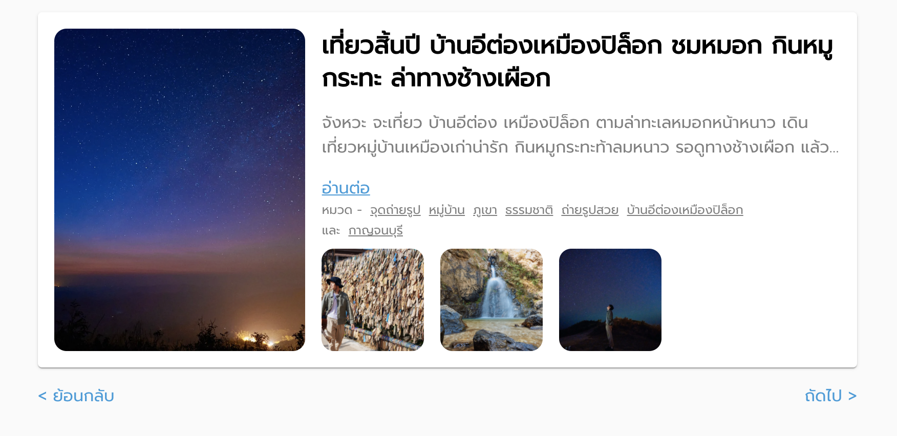
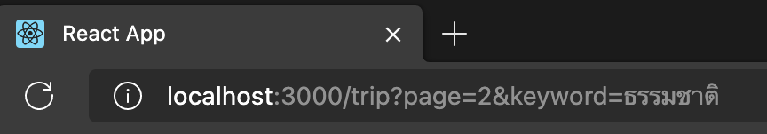
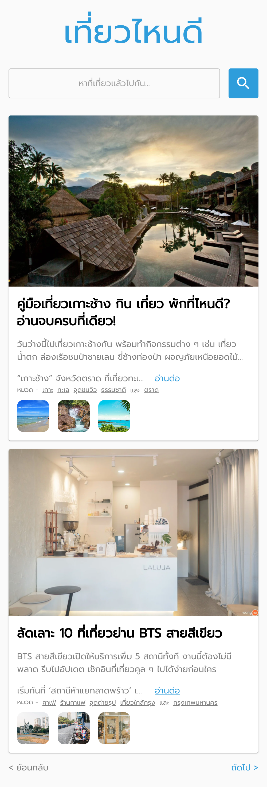

# Searching Trip

A small full-stack app for searching travel trips by keyword. It has three parts:

| Folder | What it is | Port |
| ------ | ---------- | ---- |
| [`json-server`](./json-server) | Mock data source ([json-server](https://github.com/typicode/json-server)) serving `db.json` | 9000 |
| [`api-gateway`](./api-gateway) | Express API that searches and paginates trips from the data source | 4000 |
| [`web`](./web) | React app (Material-UI, Redux, Redux-Saga) for searching and browsing trips | 3000 |

```
web (React)  ──►  api-gateway (Express)  ──►  json-server (db.json)
```



## Features

- Search trips by keyword across title, description and tags
- Live suggestions while typing (debounced)
- Click a tag to search by that tag
- Trip title and "read more" link to the trip's URL
- Photo preview for each trip
- Server-side pagination
- Shareable URL: the keyword is kept in the query string
- "Not found" state when nothing matches
- Responsive layout for mobile and desktop

## Getting started

Requirements: Node.js and Yarn.

Run each service in its own terminal, in this order:

```bash
# 1. Mock data source (port 9000)
cd json-server
yarn install
yarn start

# 2. API gateway (port 4000)
cd api-gateway
cp .env.example .env
yarn install
yarn dev

# 3. Web app (port 3000)
cd web
cp .env.example .env
yarn install
yarn start
```

Then open http://localhost:3000.

## Configuration

| Service | Variable | Default | Description |
| ------- | -------- | ------- | ----------- |
| api-gateway | `PORT` | `4000` | Port the gateway listens on |
| api-gateway | `SERVER_URI` | `http://localhost:9000/trips` | Trips endpoint of the data source |
| web | `REACT_APP_API_URL` | `http://localhost:4000` | Base URL of the API gateway |

## Project structure

```
.
├── api-gateway/
│   ├── src/
│   │   ├── app.js              # Express app entry
│   │   ├── routes/             # Route definitions
│   │   └── controller/trip/    # list + suggestion handlers
│   └── API_GATEWAY.http        # Example requests (VS Code REST Client)
├── json-server/
│   └── db.json                 # Sample trip data
├── web/
│   └── src/
│       ├── api/                # API client
│       ├── components/         # Shared components
│       ├── hooks/              # useDebounce, useRouter
│       ├── pages/Home/         # Search page, trip list, pagination
│       ├── redux/              # Store, reducers, sagas, selectors
│       └── utils/
└── docs/screenshots/
```

## API

See [`api-gateway/README.md`](./api-gateway/README.md) for the full spec.

- `GET /api/v1/trip?page=1&limit=2&keyword=...` returns a paginated trip list
- `GET /api/v1/trip/suggestion?keyword=...` returns all matching trips (for suggestions)

## Screenshots

| Searching | Not found |
| --------- | --------- |
|  |  |

| Pagination | Copy link |
| ---------- | --------- |
|  |  |

| Photo list | Mobile |
| ---------- | ------ |
|  |  |
